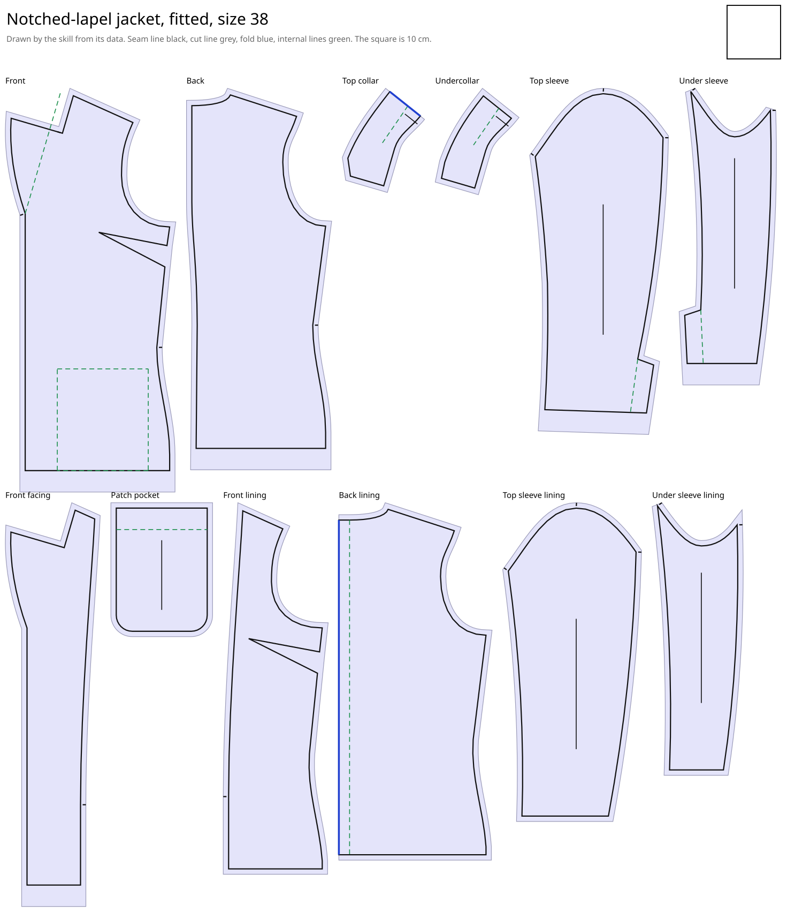

# pattern-making-skill

A skill that lets an AI agent draft garment patterns the way a pattern maker does: from body measurements and the
construction of real garments, with every seam checked, and exported at full size.

Ask the agent for a fitted jacket in a size 38, give it a photo of a coat, or hand it a sketch. It works out the
construction, drafts the pieces, checks that the edges sewn together match, and gives you a 1:1 SVG to print, a DXF
for CAD, or the assembled garment in CLO3D.



That jacket is this file, and one command:

```json
{
 "title": "Notched-lapel jacket, fitted",
 "body": "women", "size": "38",
 "fit": {"side_ease": 1.0, "arm_drop": 1.5},
 "shaping": "darts",
 "length": {"below_waist": 23},
 "front": {"extension": 2, "buttons": [22, 36]},
 "collar": {"type": "notched", "break": 22},
 "sleeve": {"length": 59, "hem": 26, "ease": 3.0, "vent": 10},
 "lining": {"hem": "jump", "up": 1.5, "cb_pleat": 2},
 "pockets": {"type": "patch", "x": 4, "y": 4}
}
```

```
python skills/pattern-making/scripts/pattern.py garment skills/pattern-making/examples/notched-lapel-jacket/jacket_fitted.json --out out
```

## It needs you

The engine is solid. The knowledge is young: of the 570 entries in its knowledge base, most describe shapes that
nobody has yet checked against a real pattern, and the project says so entry by entry in
[COVERAGE.md](COVERAGE.md).

If you draft patterns, you can fix that without writing code:

| You have | You add | |
|---|---|---|
| A value you know is wrong | a correction, or a two-minute issue | [how](CONTRIBUTING.md#correct-a-value) |
| A size chart: a method, a brand, a country | one JSON file | [how](CONTRIBUTING.md#add-a-measurement-table) |
| The proportions of a collar, a hood, a fit | a preset of a few numbers | [how](CONTRIBUTING.md#add-a-construction-preset) |
| A real pattern, one piece or all of them | its outlines and seams; the skill measures the rest | [how](CONTRIBUTING.md#add-a-pattern) |

The simplest way is to give the pattern to an agent that has the skill and say "add this to the library": it
digitises, measures every dimension itself and tells you what is missing. One command, `pattern.py check`, then
says whether the result is sound before you send it.

The repository holds data only: numbers and points, each with its source. No photo, scan or PDF of a pattern is
ever stored, yours included, and every picture you see here is drawn by the skill from the data when a contribution
is merged. Nothing from your studio needs to leave it: see [CONTRIBUTING.md](CONTRIBUTING.md).

## What it does

- **Reads the garment first.** From a photo it lists every seam, fold, piece and finish with its evidence before
  drafting. From a sketch it works out volumes and cutting, sculptural shapes included.
- **Drafts blocks**: skirt, bodice, sleeve, trousers, circle skirt, a knit option, for women, men and children, from
  standard sizes or your own measurements, with grading.
- **Drafts whole garments from a short spec**: darts, boxy or princess shaping; notched lapel, stand, funnel, shirt
  and convertible collars, hoods; two-piece, one-piece, raglan and kimono sleeves; facings, linings; patch, in-seam,
  welt and jetted pockets.
- **Drafts a leather glove** like real glove patterns: trank, Bolton thumb, fourchettes.
- **Has typical pieces ready**: collars, cuffs, plackets, pockets, flaps, hoods, gusset, godet, fly, yoke.
- **Transforms**: dart pivot, slash and spread, curve smoothing; any other garment as a recipe of pieces and seams.
- **Analyses a real pattern you give it**: digitises the pieces, then measures every dimension a pattern maker
  adjusts (lengths, girths and their ease, armhole, sleeve cap, darts, every seam) and lists what is missing.
- **Checks every draft**: edges sewn together have the same length within 1 mm unless an ease is declared with its
  reason, a piece meets its fold at a right angle, no outline crosses itself. A line marked `!!` must be fixed.
- **Exports**: 1:1 SVG, DXF, and a garment file that CLO3D builds in one call.

The agent never computes a coordinate in its head: every point goes through `pattern.py`, plain Python with no
dependency.

## Try it

```
python skills/pattern-making/scripts/pattern.py block all --body women --size 38 --out out
python skills/pattern-making/scripts/pattern.py block bodice --body men --sizes 44,48,52 --out grading
python skills/pattern-making/scripts/pattern.py garment skills/pattern-making/examples/velvet-coat/coat.json --out coat
python skills/pattern-making/scripts/pattern.py template draft shirt-cuff --param wrist=17 --out cuff
python skills/pattern-making/scripts/pattern.py kb search welt pocket
python skills/pattern-making/scripts/pattern.py data list
```

| File written | Use |
|---|---|
| `pattern.svg` | Print at 100 %, check the 10 cm square |
| `pattern_<size>.dxf` | CAD software, layers CUT, SEAM, NOTCHES, GRAIN, TEXT |
| `seams_<size>.md` | Every seam with both lengths and its declared ease |
| `clo3d_<size>.json` | The garment for CLO3D: exact curves, named edges, seams, fabric roles, arrangement points |
| `pieces_<size>.json` | Editable pieces, input of the `pivot`, `smooth` and `piece` commands |

## Install

**Claude Code**, as a plugin:

```
claude plugin marketplace add adriendelmas/pattern-making-skill
claude plugin install pattern-making@pattern-making-skill
```

**Any agent that reads skills** (Claude apps, Codex, opencode, Cursor and others): copy the folder
`skills/pattern-making` into the agent's skills folder, for example `~/.claude/skills/`.

**Agents without skill support**: give the agent `skills/pattern-making/SKILL.md` as instructions.

The engine needs Python 3.9 or newer and nothing else (`sheet.py`, which draws PNG sheets, needs Pillow). Without
Python, the agent applies the methods by hand and says the draft is unverified.

## With CLO3D

The skill computes the pattern; [clo3d-mcp](https://github.com/Ubani-Studio/clo3d-mcp) builds it in CLO3D: one
CLO3D line per pattern edge, seams by edge name, fabric by role, placement on the avatar by point name, then
simulation and fit maps.

```
python skills/pattern-making/scripts/pattern.py clo3d out/clo3d/clo3d_38.json --fabrics shell=2 --snapshots views --simulate 300
```

It needs the extended tools of clo3d-mcp (`build_garment` and its companions, version 0.2.0); while they are in
review there, they are on the `main` branch of [adriendelmas/clo3d-mcp](https://github.com/adriendelmas/clo3d-mcp).
Without CLO3D the skill is complete for pattern making and the SVG and DXF exports. Details:
[references/clo3d.md](skills/pattern-making/references/clo3d.md).

## What is in the box

```
skills/pattern-making/
  SKILL.md               what the agent reads first
  scripts/pattern.py     blocks, transformations, checks, exports, command line
  scripts/garment.py     whole garments from a spec
  scripts/templates.py   typical pieces
  scripts/library.py     the data library: loading, validation, digitising, analysis
  data/                  size tables, construction presets, digitised patterns, avatars: one JSON file each
  references/            how to analyse a photo, design from a sketch, measurements, ease, finishes, CLO3D
  references/techniques/ one sheet per garment family, accessories and sewing techniques
  references/kb/         knowledge base: one file per garment, piece or technique
  examples/              worked garment specs
CONTRIBUTING.md          how to add what you know
COVERAGE.md              what is verified and what is not, generated
CREDITS.md               every source, generated
```

## Honest limits

- A block is a starting point: validate it on a toile before cutting the fabric.
- The formulas are proportional and tied to no author. Values from a given method (Aldrich, Armstrong, Müller,
  Esmod, Bunka) come in as a measurement table or a preset.
- Shapes drafted from a description rather than from a real pattern are marked `unverified`. The skill tells the
  person when a draft rests on one.
- The CLO3D export was verified on CLO3D 2025.2: each pattern edge becomes one CLO3D line of the same length.

## Licence and credits

MIT, see [LICENSE](LICENSE). Sources of the data and the knowledge: [CREDITS.md](CREDITS.md).
CLO3D is a trademark of CLO Virtual Fashion Inc.; this project is not affiliated with or endorsed by it.
